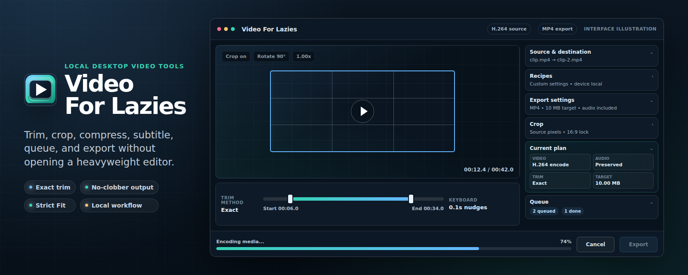

<p align="center">
  
</p>

# Video For Lazies

Video For Lazies is a focused desktop app for video jobs that should not require a full editor. Load a clip, trim or crop it, resize or compress it, and export locally through FFmpeg.

The app accepts `mp4`, `mov`, `mkv`, `avi`, `webm`, and `m4v` input and exports `mp4`, `webm`, or audio-only `mp3`. It is built with Tauri, React, Rust, and FFmpeg.

<p align="center">
  <a href="https://github.com/Setmaster/Video_For_Lazies/releases/latest" aria-label="Download the latest Video For Lazies release">
    
  </a>
</p>

## Highlights

### Edit in one workbench

- Keep the preview, scrubber, trim controls, and crop surface visible while settings stay in a collapsible side rail.
- Use one frame-accurate trim workflow. Requested boundaries use decoded frames and samples so trimming never silently retains material outside the selected interval.
- Crop by drawing over the preview, editing labelled source-pixel fields, or running crop detection. Quarter-turn rotation keeps the preview, pointer mapping, and source crop coordinates aligned.
- Resize by original dimensions, max edge, or custom dimensions; rotate, reverse, create a forward-then-reverse loop, change playback speed, and adjust brightness, contrast, and saturation.
- Apply a frame-rate cap to the post-speed frame rate. The current plan reports when the cap changes the output.
- Enable **Smooth motion** for local AI frame interpolation at 60 or 120 fps. RIFE 4.25 is included; additional models install with one button, without manual Python or CUDA setup.
- Burn one validated UTF-8 `.srt` file into MP4 or WebM using source-timeline timing and a fixed bottom-centered style. Subtitles force video re-encoding; inline HTML/ASS styling and positioning overrides are rejected.
- Save the current preview frame as PNG when the source has standard 8-bit SDR color and square pixels.

### Make output behavior visible

- Probe the selected container and streams before planning. Attached pictures are ignored as primary video, and compatible video and audio streams may be copied independently when the requested output permits it.
- Auto-suggest a fresh `-N` destination, reserve queue destinations, write through a process-unique temporary file, and publish without replacing an existing file.
- Treat decimal size limits as exact integer-byte targets. With **Strict Fit** off, the requested dimensions and audio are preserved and an oversized result is still published as a clearly marked target-miss artifact with exact byte counts.
- Opt into **Strict Fit** for at most four ordered plans. It stops at the first result that fits, otherwise keeps the smallest measured miss. When **Include audio** is enabled, every plan retains audio and the final applicable fallback uses 32 kbps audio.
- Inspect the effective mode, stream actions, codecs, target and actual bytes, color/SAR handling, and a redacted FFmpeg command preview after export.
- Override codec, quality, encode speed, frame-rate cap, color range, audio bitrate, or channel layout when Auto is not the right fit, and optionally normalize quiet or uneven speech.
- Choose **Auto**, **Limited**, or **Full** color range in Advanced. Auto preserves existing behavior; explicit choices convert pixel values and signal their range together. Full range requires H.264 or VP9 and cannot be combined with required Standard SDR conversion.
- Strip GPS and capture metadata by default, with an explicit privacy toggle and optional title metadata.
- Follow visible **Copying**, **Encoding**, and **Finalizing** progress. Active work stays below 100 percent until the backend reports a terminal result.

### Queue files and reuse settings

- Queue immutable export snapshots and run them sequentially with one FFmpeg job at a time. Completed, target-missed, failed, and canceled items keep bounded recent diagnostics and can be retried, duplicated, or applied back to the workbench with a fresh output path.
- Add multiple files from the picker or drop them anywhere in the window. One supported file dropped while idle becomes the current source; multiple files, or files dropped during an export, are queued in order with the current reusable settings. Unsupported, duplicate, and overflow entries are reported.
- Save, rename, apply, and delete up to 50 user recipes on the current device. Recipes use a privacy-bounded allowlist and never store media/output/subtitle paths, titles, trim, crop, transforms, HDR conversion choices, diagnostics, or queue/job state. The reusable Advanced color-range preference is saved.
- Use built-in starting points for quick sharing, size-limited uploads, archive-quality MP4, smaller WebM, and audio-only MP3.
- The **Forum 4 MB** recipe selects limited color range for upload compatibility, alongside its size target, audio removal, and unique-export setting. It preserves unrelated settings.
- Use the separate **Cancel** action to request cancellation of the active export. **Reset all settings** asks for confirmation and does not remove the current source, output path, queue, or saved recipes.

### Guard unsafe media assumptions

- HDR10 and high-bit-depth SDR video require an explicit conversion to 8-bit BT.709 SDR MP4. HLG, Dolby Vision, contradictory/incomplete HDR metadata, unknown pixel depth, and unsupported rotation fail closed for video export; audio-only MP3 can remain available.
- Non-square source pixels are normalized to square-pixel video while preserving visible shape unless custom dimensions explicitly take authority.
- Reverse and loop plans estimate decoded memory, warn above the soft bound, and refuse plans above the hard safety limit.
- The tested accessibility baseline includes keyboard-operable trim sliders, labelled crop fields, focus-contained dialogs with background isolation and focus return, and live status or alerts for relevant asynchronous work. This is not a claim of WCAG conformance or complete assistive-technology coverage.

## Who It Is For

Use Video For Lazies when you need a focused export pass instead of a full editing session: quick clips, smaller uploads, screen recordings, simple crops, speed changes, subtitles, batches, or a measured attempt to fit under a size limit.

It is not a nonlinear editor. There are no multi-track timelines, effects stacks, or media bins.

## Download

Download the latest stable portable zip from [GitHub Releases](https://github.com/Setmaster/Video_For_Lazies/releases/latest).

- Windows x64: `Video_For_Lazies-vX.Y.Z-win-x64.zip`
- Linux x64: `Video_For_Lazies-vX.Y.Z-linux-x64.zip`
- Checksums: `SHA256SUMS.txt`

The portable builds bundle pinned FFmpeg and FFprobe sidecars, so end users do not need to install FFmpeg separately for supported Windows and Linux releases.

Updater-capable releases verify a signed update manifest and the selected portable payload before replacement. The updater shows bounded progress, keeps a recovery journal and verified backup, and attempts rollback or startup recovery after an interrupted replacement. If automatic recovery cannot finish, the app keeps the recovery state visible and links to the portable downloads. Update prompts offer `Update now`, `Remind me later`, and `Skip` for seven days.

Windows builds are unsigned, so Windows may show SmartScreen or antivirus reputation warnings. Verify the checksum before running downloaded binaries.

Verify on Linux:

```bash
sha256sum -c SHA256SUMS.txt --ignore-missing
unzip Video_For_Lazies-vX.Y.Z-linux-x64.zip
./Video_For_Lazies/video_for_lazies
```

Verify on Windows PowerShell:

```powershell
Get-FileHash .\Video_For_Lazies-vX.Y.Z-win-x64.zip -Algorithm SHA256
Select-String -Path .\SHA256SUMS.txt -Pattern "Video_For_Lazies-vX.Y.Z-win-x64.zip"
Expand-Archive .\Video_For_Lazies-vX.Y.Z-win-x64.zip -DestinationPath .
.\Video_For_Lazies\Video_For_Lazies.exe
```

## Report a Bug

[Submit a bug report](https://vfl-bugs.7dev.io/) without a GitHub account. Reports become public GitHub issues, so remove private information before submitting. You can copy or save your draft if submission fails.

For security vulnerabilities, use [private vulnerability reporting](https://github.com/Setmaster/Video_For_Lazies/security/advisories/new). Service setup and maintenance are documented in [docs/reporting.md](docs/reporting.md).

## Usage Notes

- Size targets use decimal MB: `1 MB = 1,000,000 bytes`.
- Set size limit to `0`, or leave it empty, to disable size targeting.
- Size targeting is measured, not a guarantee. Strict Fit is bounded and can still publish a target miss.
- Queue items are snapshots. Changing settings after adding an item does not rewrite it.
- Same-settings multi-file batches intentionally exclude clip-scoped trim, crop, transform, color/HDR, title, and external subtitle state.
- Bundled MP4 export uses H.264. In Auto mode, a custom FFmpeg without `libx264` can fall back to `mpeg4` when that encoder is available; an explicit H.264 or standard-SDR plan fails closed instead.
- Process media files you trust. Video For Lazies runs FFmpeg locally as your user, so hostile media exercises the active FFmpeg build.

### Screen recording on Windows

Open the **Record** tab, choose a display, then select **Full screen** or draw an **Area** with the mouse. Choose a local output folder and click **Start recording**. Recording uses a bundled helper, with no OBS or recording-runtime installation. Linux recording is not available yet; editing remains available on both platforms.

System audio and microphone are independent options, both off initially. Choose an available device for each enabled source. Recordings save as H.264 MP4 with AAC when audio is enabled. HDR displays are converted to SDR BT.709; HDR output is not preserved. Odd-sized areas retain every selected pixel and add a black edge for even MP4 dimensions.

Choose 24, 25, 30, 50 or 60 fps, Standard or High quality, a visible cursor, and a 0/3/5-second countdown. High quality uses more disk space. Available resolution and frame rate depend on capture and encoder throughput; the app reports a failure instead of silently reducing either setting.

Use **Stop and save**, the native Stop control, or **Ctrl+Shift+F10** when that shortcut is available. Wait for **Recording saved**, then open the MP4 or choose **Edit video**. Closing during recording offers **Stop and save** or **Keep open**. Interrupted recordings appear under **Unfinished recordings** for recovery; an unfinished ending may be lost. Temporary files can be larger than the saved MP4, especially with audio. Keep extra free space. Existing output files are preserved.

### Smooth motion

Turn on **Smooth motion**, choose 60 or 120 fps, and export MP4 or WebM. The ordinary preview shows your source; **Export exact sample** in Advanced runs the interpolation pipeline for a short output you can inspect first. The setting is saved in recipes and queue snapshots.

RIFE 4.25 is included in the portable folder. Select RIFE 4.26, GMFSS Fortuna (Union), GIMM-VFI-R-P or LDF-VFI and click **Install frame interpolation** to download it. Hover or focus a model in the menu for a short description. GIMM's tooltip includes a red **noncommercial** marker; its upstream license restricts use.

RIFE uses a hardware Vulkan GPU and its vendor driver. GMFSS, GIMM and LDF require an NVIDIA GPU with a current driver. Their first installation also downloads a shared, app-local Python/Torch runtime, approximately 3 GB on Windows or 4.3 GB on Linux, with no manual Python, CUDA toolkit or compiler setup. LDF adds approximately 6.4 GB of model data, needs BF16 support and substantially more GPU memory, and requires compatible constant frame timing. The other optional models have smaller model downloads. Installed models work offline; removing one keeps the shared runtime for the others.

Downloads show progress and support cancellation and retry. The app verifies source, model and runtime sizes and SHA256 hashes and runs a local inference test before activating a download. Video frames stay on your device. Unsupported devices and incompatible model timing show an explanation instead of silently switching models or using the CPU.

Interpolation currently accepts supported 8-bit SDR video with known frame timing. The app rejects incompatible media before export. A frame-rate cap below the chosen target must be removed or raised. Generated frames are cached once per export and reused by size-target attempts; allow temporary disk space for the lossless video cache. Interpolation can take substantially longer than an ordinary export, especially at high resolutions. Inspect a sample for artifacts around cuts, fine details and fast motion.

## From Source

Requirements:

- Node.js
- Rust toolchain
- CMake and a C++17 compiler for the native interpolation worker; Linux also needs Ninja. Windows needs the Visual Studio C++ tools and CMake component.
- Supported source targets are Windows x64 and Linux x64. Both stage pinned FFmpeg/FFprobe and build the native interpolation worker automatically.
- Custom FFmpeg runtimes can use `VFL_FFMPEG_PATH` and `VFL_FFPROBE_PATH`.

Run the app:

```bash
cd app
npm install
npm run tauri dev
```

Build the app:

```bash
cd app
npm run tauri build
```

## Portable Builds

```bash
cd app
npm run portable
```

This writes `release/Video_For_Lazies/` with the app executable, update helper, bundled `ffmpeg-sidecar/`, `interpolation-sidecar/` worker and RIFE 4.25 model, capability contract, payload manifest, embedded subtitle support, and required project/legal files. Keep the whole folder together. The portable command performs the platform build; Windows also runs its baseline packaged-window startup check.

To create and fully verify a release archive:

```bash
cd app
npm run release:portable
```

The release command creates a versioned x64 zip and `SHA256SUMS.txt`, validates the extracted payload manifest and legal/source inventory, verifies the pinned FFmpeg capability contract with a real encode/probe, and runs the cross-platform packaged media, workflow, exact-trim, no-clobber, accessibility, progress, cancellation, and export-lifecycle smoke matrices. Linux also runs the complete codec-plan matrix; Windows also performs the native packaged-window startup and update-helper checks.

Release process details are in [`docs/release.md`](docs/release.md).

## Tests

```bash
cd app
npm test
npx tsc --noEmit
npm run build
cargo test --manifest-path src-tauri/Cargo.toml
cargo fmt --manifest-path src-tauri/Cargo.toml -- --check
cargo clippy --manifest-path src-tauri/Cargo.toml --all-targets --all-features -- -D warnings
```

## FFmpeg And Licensing

Video For Lazies is licensed under GPL-3.0-or-later. See [`LICENSE`](LICENSE).

Windows x64 and Linux x64 portable builds bundle pinned GPL FFmpeg runtimes as sidecars. Runtime resolution order is:

1. `VFL_FFMPEG_PATH` / `VFL_FFPROBE_PATH`
2. bundled `ffmpeg-sidecar/` next to the app executable
3. plain `ffmpeg` / `ffprobe` on `PATH`

Bundle provenance, exact URLs, checksums, and corresponding source information are documented in [`docs/ffmpeg-bundling.md`](docs/ffmpeg-bundling.md). Third-party notices are in [`THIRD_PARTY_NOTICES.md`](THIRD_PARTY_NOTICES.md), and source availability notes are in [`SOURCE.md`](SOURCE.md). Portable builds copy generated release-specific versions of those notice files into each zip.

## Security

Please report security issues privately. See [`SECURITY.md`](SECURITY.md).
